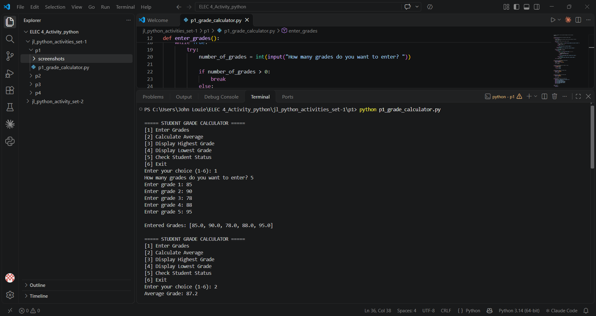
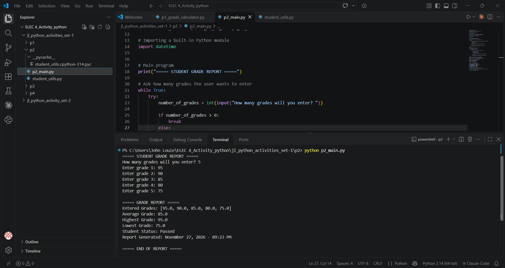
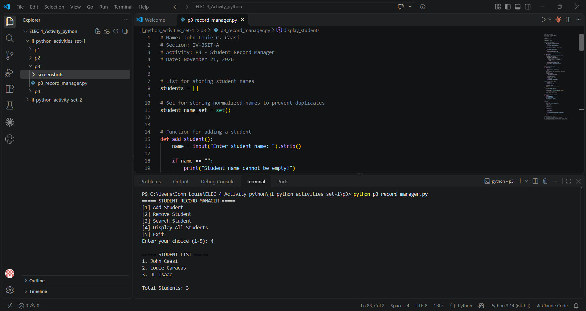
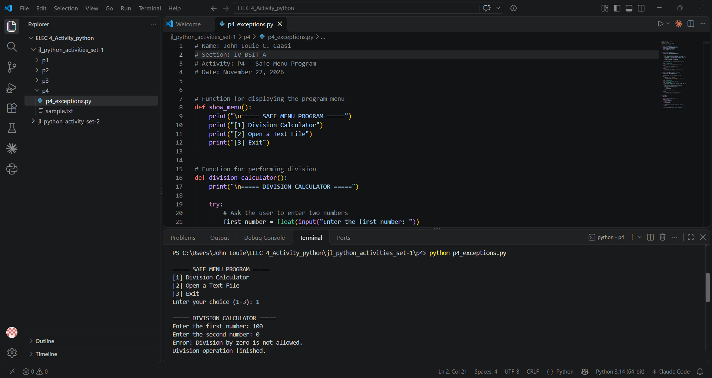

# ELEC 4 - Python Programming

## Student Information

Name: John Louie C. Caasi  
Section: IV-BSIT-A  
Course: ELEC 4 - Python Programming  
University: Pangasinan State University Lingayen Campus 

## About the Repository

This repository contains my self-paced learning activities
for ELEC 4 - Python Programming. These activities demonstrate
the application of functions, modules, lists, sets,
input validation, and exception handling.

## Set 1 Activities

| Activity | Description | Folder |
| --- | --- | --- |
| P1 - Student Grade Calculator | Calculates the average, highest, and lowest grades and determines pass or fail status. | [View Activity](set1/p1/) |
| P2 - Custom Module: student_utils | Generates a student grade report using reusable functions from a custom module. | [View Activity](set1/p2/) |
| P3 - Student Record Manager | Adds, removes, searches, and displays student names while preventing duplicate entries. | [View Activity](set1/p3/) |
| P4 - Safe Menu Program | Handles invalid inputs, division by zero, missing files, and invalid menu selections. | [View Activity](set1/p4/) |

## Requirements

- Python 3
- Visual Studio Code or any Python editor

## How to Run the Activities

Open the repository in your code editor and execute the
following commands in the terminal from the repository
root directory unless otherwise specified.

### P1 - Student Grade Calculator

```bash
python set1/p1/p1_grade_calculator.py
```

Sample Output:



[View all P1 screenshots](set1/p1/screenshots/)

### P2 - Custom Module: student_utils

```bash
python set1/p2/p2_main.py
```

Sample Output:



[View all P2 screenshots](set1/p2/screenshots/)

### P3 - Student Record Manager

```bash
python set1/p3/p3_record_manager.py
```

Sample Output:



[View all P3 screenshots](set1/p3/screenshots/)

### P4 - Safe Menu Program

```bash
cd set1/p4
python p4_exceptions.py
```

Use `sample.txt` to test the open file option.

After exiting the program, return to the repository root:

```bash
cd ../..
```

Sample Output:



[View all P4 screenshots](set1/p4/screenshots/)
